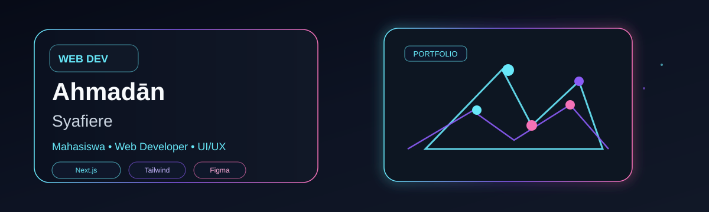

# Ahmadān Syafiere 👋

  

  
  
  

  

  <table>
    <tr>
      <td>
        
      </td>
      <td>
        
      </td>
    </tr>
  </table>

<h3 align="center">Core Stack</h3>

  

<h3 align="center">Featured Work</h3>

<table>
  <tr>
    <td width="33%">
      

          
        <b>Portfolio Website</b> 
        <small>Modern showcase + case study + brand identity.</small>
      

    </td>
    <td width="33%">
      

          
        <b>Academic System</b> 
        <small>Student data, courses, grade management app.</small>
      

    </td>
    <td width="33%">
      

          
        <b>Design Prototype</b> 
        <small>Interface flow, mockup, and UX decisions.</small>
      

    </td>
  </tr>
</table>

<h3 align="center">Currently Focused</h3>

  
  
  
  

  <b>Indonesia • Mahasiswa Sistem Informasi</b> 
  <i>Web Developer • UI/UX Enthusiast • Product-minded builder</i>

  <a href="https://ahmadcoderfolio.vercel.app/" target="_blank">Portfolio</a> •
  <a href="https://github.com/Ahmadhan2005" target="_blank">GitHub</a> •
  <a href="mailto:emailkamu@example.com">Email</a>

  

