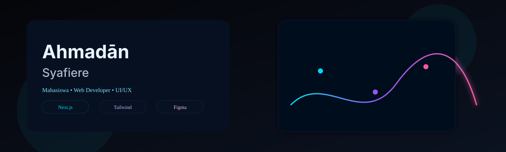
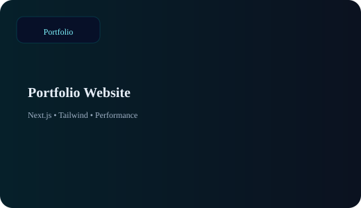
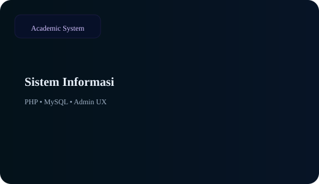
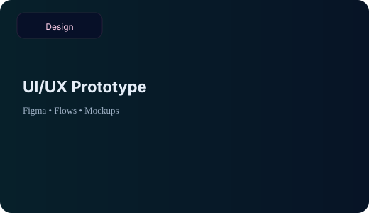

<!-- ============ HEADER ============ -->
<div align="center">

  <g clip-path="url(#clip)">
    <rect width="900" height="300" fill="url(#bg)"/>
    <rect width="900" height="300" fill="url(#grid)" opacity="0.6">
      <animateTransform attributeName="transform" type="translate" from="0 0" to="30 30" dur="4s" repeatCount="indefinite"/>
    </rect>




<br/>

<a href="https://github.com/Ahmadhan2005">
  
</a>

<br/><br/>

<a href="https://ahmadcoderfolio.vercel.app/"></a>
<a href="https://github.com/Ahmadhan2005"></a>
<a href="mailto:emailkamu@example.com"></a>

<br/><br/>


</div>


## `> whoami`

```ts
const ahmadan = {
  name:     "Ahmadān Syafiere",
  role:     ["Web Developer", "UI/UX Enthusiast"],
  status:   "Mahasiswa Sistem Informasi",
  location: "Indonesia 🇮🇩",
  focus:    ["Next.js", "Tailwind CSS", "Clean UI", "Performance"],
  learning: ["TypeScript", "System Design", "Motion UI"],
  motto:    "Minimal • Dark futuristic • Neon accents",
};
```


## `> featured --projects`

<p align="center">
  
  
  
</p>

| 🚀 Project | 🧩 Stack | 🏷️ Kategori |
| :-- | :-- | :-- |
| **Portfolio Website** | Next.js • Tailwind • Performance | Portfolio |
| **Sistem Informasi** | PHP • MySQL • Admin UX | Academic System |
| **UI/UX Prototype** | Figma • Flows • Mockups | Design |

<p align="center">
  <a href="https://ahmadcoderfolio.vercel.app/">
    
  </a>
</p>


## `> tech --stack`

<p align="center">
  
</p>


## `> stats --live`

<p align="center">
  
  
</p>

<p align="center">
  
</p>

<p align="center">
  
</p>


<!-- ============ FOOTER ============ -->
<div align="center">

**Indonesia • Mahasiswa Sistem Informasi**<br/>
Web Developer • UI/UX Enthusiast

<a href="https://ahmadcoderfolio.vercel.app/">Portfolio</a> •
<a href="https://github.com/Ahmadhan2005">GitHub</a> •
<a href="mailto:emailkamu@example.com">Email</a>


</div>
